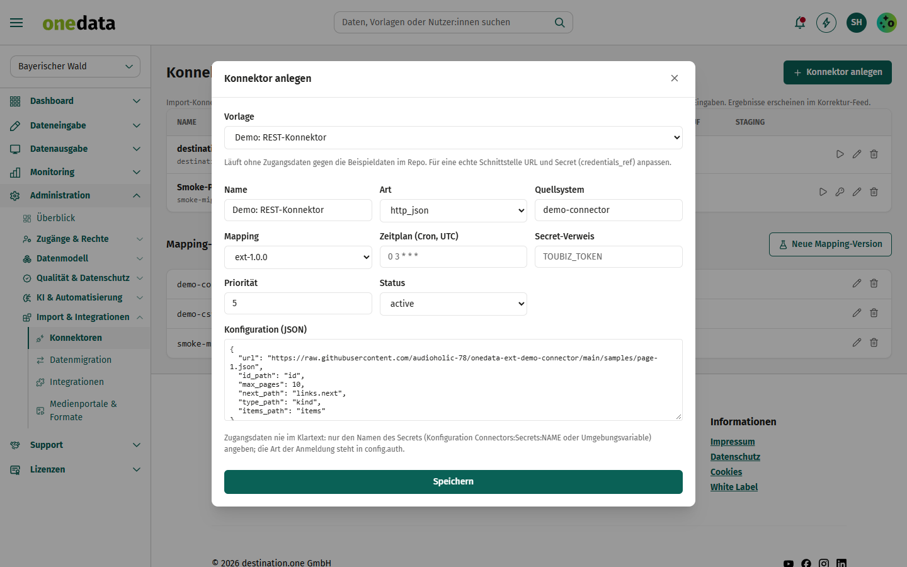

# Demo: REST-Konnektor

Vorlage für Partner, die ihre Schnittstelle als **Konnektor** im od marketplace anbieten möchten.

## Anbieter

**destination.one GmbH** – Hersteller von one.data, dem Redaktionssystem für Tourismusdestinationen.

- Web: [www.destination.one](https://www.destination.one)
- Kontakt: [info@destination.one](mailto:info@destination.one)

## Kurzbeschreibung

Ruft eine paginierte JSON-Schnittstelle ab (Sehenswürdigkeiten und Ausflugsziele), übernimmt die Daten ins Staging und
importiert sie mit dem mitgelieferten Mapping – zeitgesteuert per Cron.

## Beschreibung

Ein Konnektor holt Daten regelmäßig aus einem Fremdsystem. Diese Extension nutzt den eingebauten generischen
REST/JSON-Konnektor von one.data (`base_kind: http_json`) und liefert nur noch **Konfiguration und Mapping** mit:

- **Abruf:** `url`, `items_path` (Liste der Datensätze), `id_path`, `type_path`
- **Paging:** `next_path` zeigt auf die URL der nächsten Seite (`links.next`), höchstens `max_pages` Seiten
- **Delta (optional):** `since_param` hängt den Zeitpunkt des letzten Laufs als Query-Parameter an
- **Zugangsdaten:** nie im Paket – beim Anlegen des Konnektors nur den *Namen* eines Secrets hinterlegen
  (`credentials_ref`), dazu `auth` (`bearer`, `basic`, `header`, `query`) in der Konfiguration

### So funktioniert es

1. Extension im od marketplace für die Instanz **aktivieren**.
2. *Administration → Konnektoren → Neuer Konnektor*: Vorlage „Demo: REST-Konnektor“ wählen. URL, Paging und die
   Mapping-Version `ext-1.0.0` sind vorbelegt.
3. **Jetzt ausführen** oder einen Zeitplan (Cron, UTC) setzen. Ergebnisse stehen im Import-Lauf bzw. Korrektur-Feed.

### Remote-Variante

Reicht die Konfiguration nicht aus (z. B. Signaturen, SOAP, eigene Logik), kann ein Partner einen eigenen Webdienst
betreiben: `runtime: "remote"` mit `remote.base_url`. one.data ruft dann `POST {base_url}/fetch` auf (HMAC-signiert)
und erwartet `{ "records": [{ "source_id", "source_type", "raw" }], "next_cursor" }`. Vertrag:
*docs/contracts/extension-remote-v1.md* im one.data-Repo.
